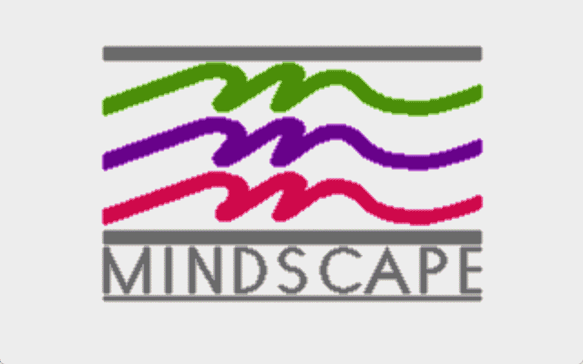
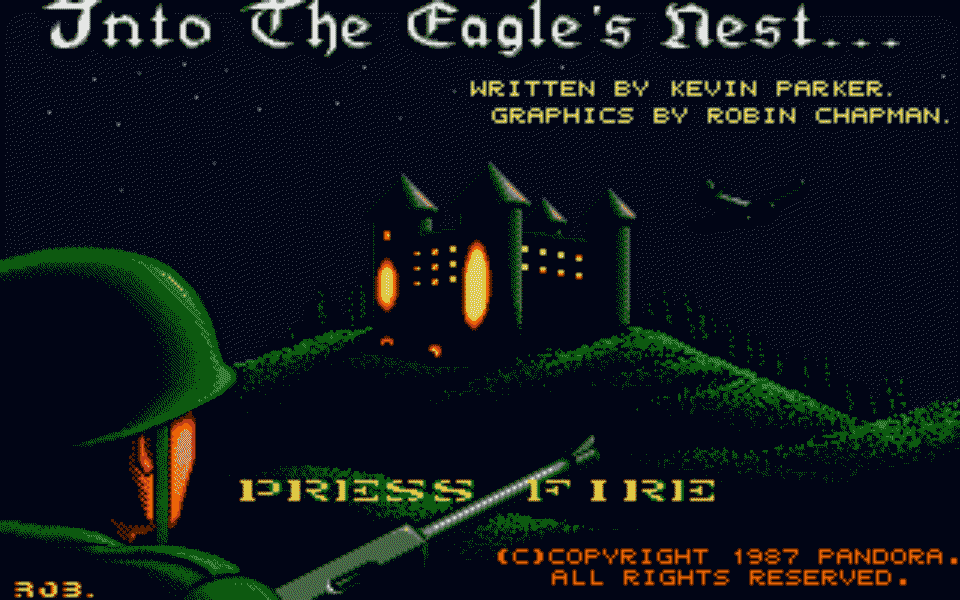
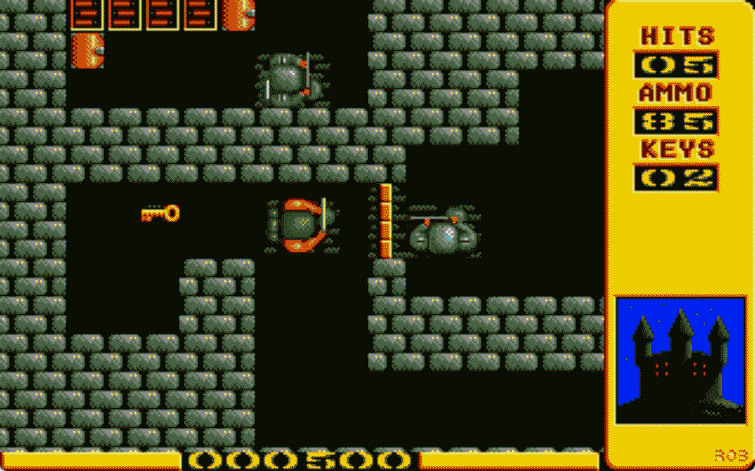
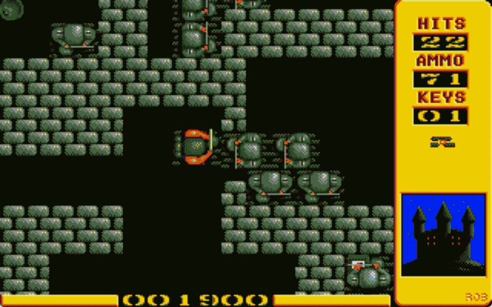
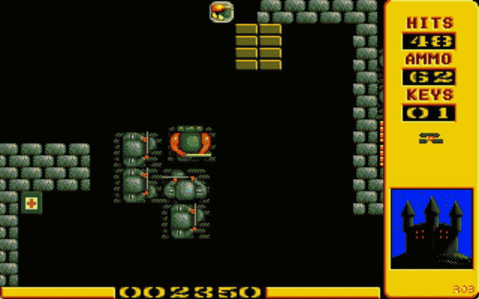

> [!CAUTION]
> # COMING SOON

# Into the Eagle's Nest Port

A cross-platform port of the original Amiga game *Eagle's Nest* to C using [SDL3](https://www.libsdl.org/).

## Screenshots

<table>
  <tr>
    <td></td>
    <td></td>
  </tr>
  <tr>
    <td></td>
    <td></td>
  </tr>
  <tr>
    <td></td>
    <td></td>
    <td></td>
  </tr>
</table>

## About

This project is an attempt to faithfully recreate the gameplay of the original *Eagle's Nest*. The port is written in pure C, uses SDL3 as its only external dependency, and includes a built-in ProTracker MOD decoder for music playback.


## Features

- **Faithful recreation** - Game logic closely matches the original, including mission selection, elevators, detonators, prisoner rescue, and more
- **SDL3 only** - Music is played by the built-in decoder in `src/audio/mod.c`
- **Cross-platform** - Supports Linux, Windows, and macOS
- **Input support** - Keyboard and gamepad
- **High score system** - Save high scores with name entry
- **Cheat codes** - Available via command-line arguments
- **Two executables**:
  - `eaglenest` - Main game
  - `mapview` - Map inspector for viewing levels with coordinates in console
- **Debugging** - Framebuffer screenshots can be saved via the `EAGLE_DUMP_DIR` environment variable

## Build Requirements

| Platform | Dependencies |
|----------|--------------|
| Linux | `cmake`, `pkg-config`, `gcc`/`clang`, `libsdl3-dev` |
| Windows (MSYS2/MinGW) | `cmake`, `pkg-config`, `mingw-w64-*-gcc`, `mingw-w64-*-SDL3` |
| macOS | Xcode Command Line Tools, [Homebrew](https://brew.sh/), `cmake`, `pkg-config`, `sdl3` |

## Building

Pre-converted assets are already included in the `assets/` directory, so no asset conversion is required for a standard build.

### Linux

The easiest way is to use the build script:

```bash
./build_linux.sh
```

Or build manually with CMake:

```bash
mkdir build && cd build
cmake .. -DCMAKE_BUILD_TYPE=Release
make -j$(nproc)
```

The built binary will be in `build/dist/eaglenest`.

### Windows

Use one of the provided batch scripts with MSYS2/MinGW:

```bash
build_windows_mingw.bat
# or
build_windows.bat
```

Or build manually with CMake. On Windows, CMake will automatically copy required DLLs next to the executable.

### macOS

Install dependencies as described below, then build:

```bash
# Build for native architecture (arm64 on Apple Silicon, x86_64 on Intel)
./build_macos.sh

# Build universal binary for both Intel and Apple Silicon
./build_macos.sh --universal
```

Built binaries will be in `build/dist/` or `build/eaglenest_universal` if using the `--universal` flag.

## Installing Dependencies on macOS

1. Install Xcode Command Line Tools:
```bash
xcode-select --install
```

2. Install [Homebrew](https://brew.sh/) if not already installed:
```bash
/bin/bash -c "$(curl -fsSL https://raw.githubusercontent.com/Homebrew/install/HEAD/install.sh)"
```

3. Install dependencies:
```bash
brew install cmake pkg-config sdl3
```

> On first launch of a downloaded binary on macOS, you may see a security warning. You can allow it in `System Settings > Privacy & Security`.

## Running

After building, run `eaglenest` from the `dist/` directory (or `build/dist/`) so it can find the `assets/` folder next to it:

```bash
cd build/dist
./eaglenest
```

To run the map inspector:

```bash
./mapview
```

## Controls

| Key/Button | Action |
|------------|--------|
| Arrow keys / WASD | Movement |
| Space / Left Mouse / Gamepad Button | Fire |
| ESC | Pause |
| Alt+M | Toggle music |
| Alt+S | Toggle sound effects |

Additional options are available in the pause menu: Resume (R), Restart level (L), Return to main menu (M), Quit (Q).

## Asset Conversion

If you need to rebuild assets from the original Amiga data, use the `convert_assets` tool:

```bash
cd build
./convert_assets /path/to/original/eaglenest/data ../assets
```

Or build the `assets` CMake target:

```bash
cmake --build . --target assets
```

## Project Structure

```
eaglenest-port/
├── src/           # Game source code
│   ├── audio/     # Audio system and ProTracker decoder
│   ├── core/      # Platform abstraction and memory management
│   ├── game/      # Game logic
│   ├── gfx/       # Rendering, palette, and tiles
│   ├── input/     # Input handling
│   └── main.c     # Entry point
├── tools/         # Utilities (convert_assets)
├── assets/        # Pre-converted game assets
└── CMakeLists.txt # Build configuration
```

## License

### Source Code
The source code written for this port is made available under the **MIT License** (see the `LICENSE` file for details). You are free to use, modify, and distribute the code.

### Audio Assets
All music themes and sound effects included in this repository are original works created by the author of this port. All rights reserved / licensed under [Copyright © 2026 dudorov@gmail.com].

### Graphics Assets
The rights to the original *Into the Eagle's Nest* game, including all sprites, tiles, and visual artwork used in the `assets/` directory, belong to their respective original authors and publishers (Pandora Software / Mindscape). 

These pre-converted graphics assets are included strictly for educational, research, and non-commercial preservation purposes. If you plan to distribute, publish, or commercially use this project, you must ensure you have the appropriate rights to these original assets or replace them entirely.


## Credits

* Original *Eagle's Nest* developers for creating this great game.
* **[hitchhikr](https://github.com/hitchhikr)** — Huge thanks and deepest gratitude for **[A complete disassembly of the Amiga version of the game "Into The Eagle's Nest"](https://github.com/hitchhikr/eaglenest)**. This project and historical preservation work made this port possible.
* The retro gaming community for ongoing research, passion, and documentation of the original version.
